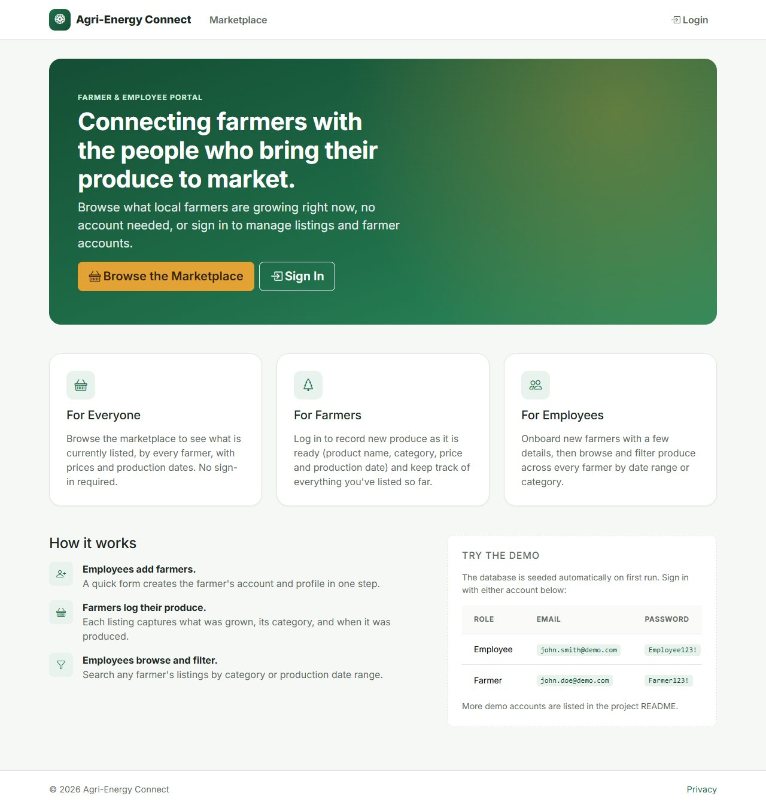
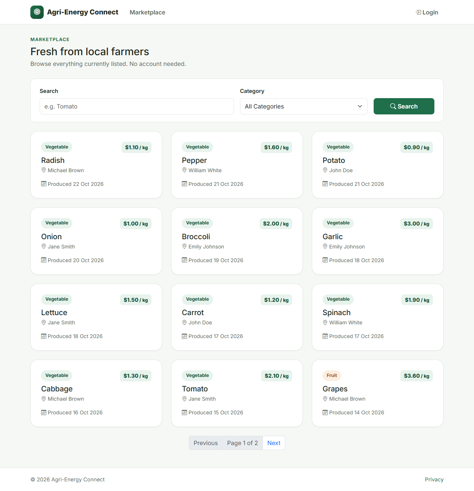
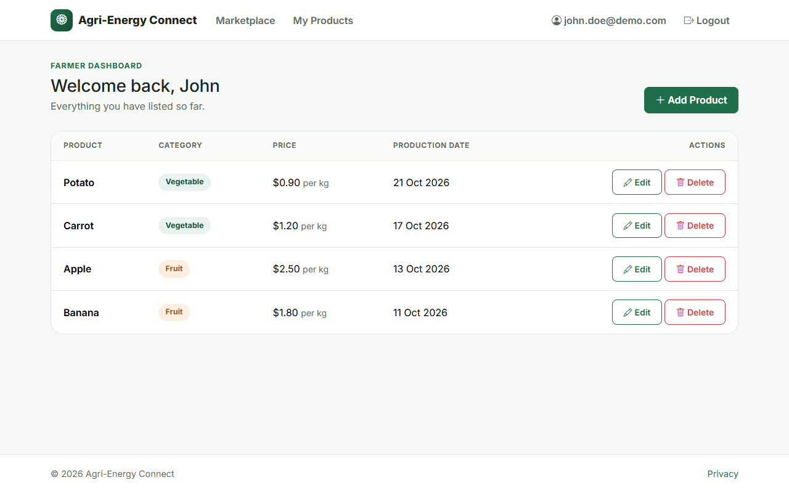
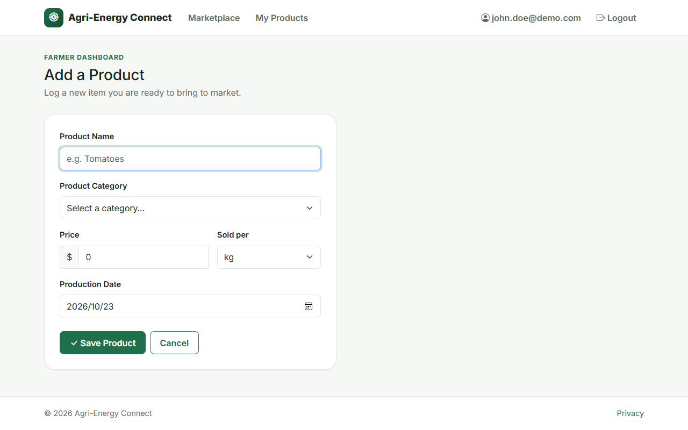
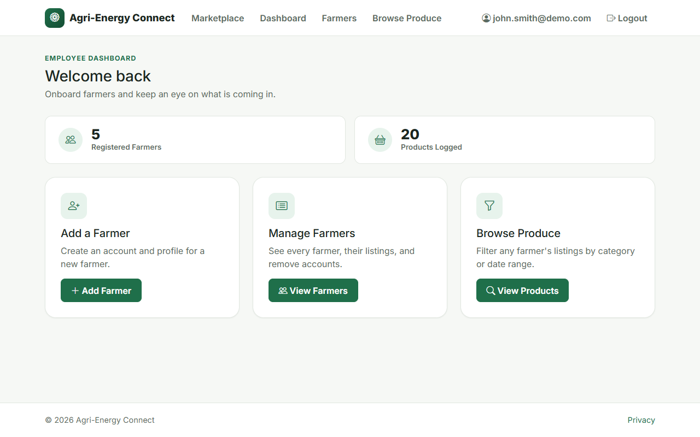
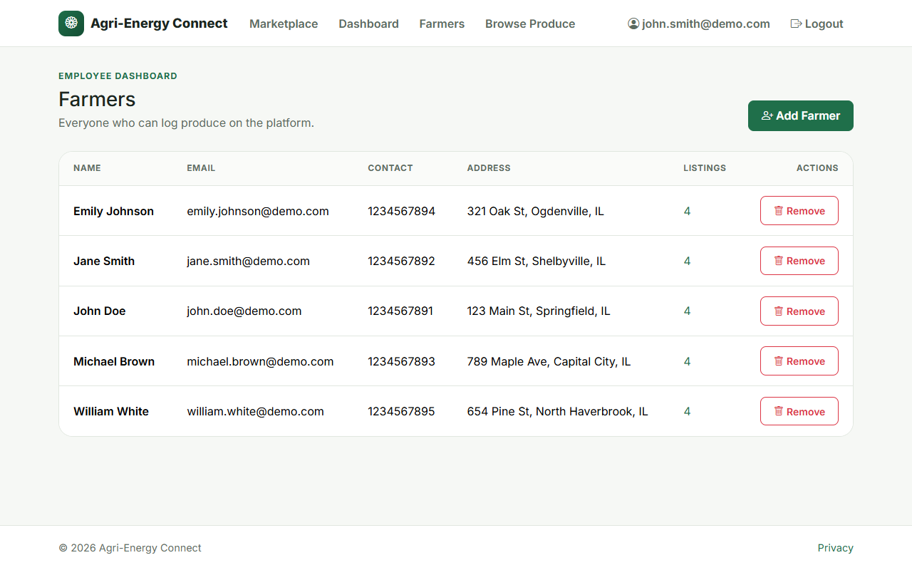
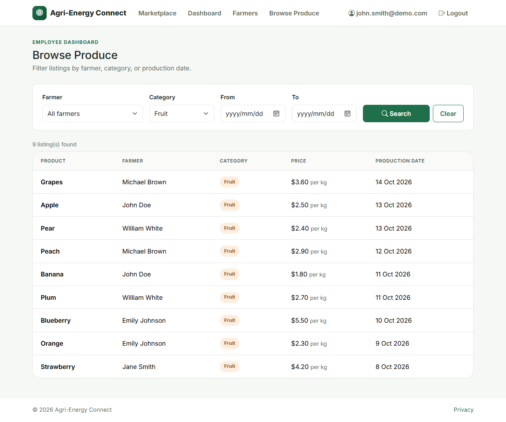
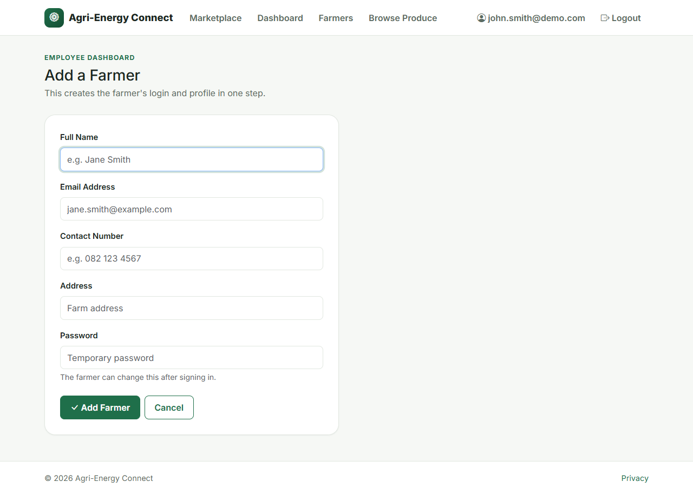

# Agri-Energy Connect

[](https://github.com/MrPettitt/AgriEnergyConnect/actions/workflows/ci.yml)

A web app that connects farmers with the employees who manage their produce
listings. Employees onboard farmers, farmers log what they have grown, and
anyone can browse the public marketplace.

Built with **ASP.NET Core 8 (MVC)**, **EF Core** and **ASP.NET Core Identity**
for role-based authentication (`Farmer` / `Employee`).

## Screenshots

| | |
|---|---|
|  |  |
| **Home**: public landing page | **Marketplace**: search, category filter and paging |
|  |  |
| **Farmer dashboard**: edit and delete own listings | **Add product**: category and unit lists, validated input |
|  |  |
| **Employee dashboard** | **Farmers**: listing counts and account removal |
|  |  |
| **Browse produce**: filter by farmer, category and dates | **Add farmer**: creates the login and profile together |

## Features

- **Public marketplace**: anyone can browse every farmer's current listings, with
  search, category filtering and paging. No account required.
- **Role-based accounts**: Identity-backed login with two roles, each landing on
  its own dashboard. Failed logins lock the account out temporarily.
- **Employees** can:
  - onboard new farmers (creates the login and the profile in one step),
  - see all farmers and remove an account together with its listings,
  - browse produce across all farmers, filtered by farmer, category and
    production date range, with shareable URLs and paging.
- **Farmers** can add, edit and delete their own produce listings (name,
  category, price per unit, production date). Ownership is enforced on the
  server, so one farmer can never change another's listings.
- **Validated input**: categories and units come from fixed lists, prices must be
  positive, and production dates cannot be in the future.
- **Zero-setup run**: a local SQLite database is created from EF Core migrations
  on first start. No SQL Server or connection-string configuration needed.

## Tech stack

| Layer     | Technology |
|-----------|------------|
| Framework | ASP.NET Core 8 (MVC, Razor views) |
| Auth      | ASP.NET Core Identity (cookie auth, role-based authorization) |
| Data      | EF Core 8 + SQLite, migrations |
| Front end | Bootstrap 5, Bootstrap Icons, jQuery validation (CDN, with integrity hashes) |
| Tests     | xUnit with in-memory SQLite |

## Getting started

**Prerequisite:** the [.NET 8 SDK](https://dotnet.microsoft.com/download/dotnet/8.0).

```bash
git clone https://github.com/MrPettitt/AgriEnergyConnect.git
cd AgriEnergyConnect
dotnet run
```

Open the URL shown in the console (for example `https://localhost:7268`). On the
first run the database file `AgriEnergyConnect.db` is created in the project
directory and, in the `Development` environment, filled with the demo data below.

Alternatively, open `AgriEnergyConnect.sln` in Visual Studio, Rider or VS Code and
press Run.

### Running the tests

```bash
dotnet test
```

### Demo accounts

Demo data is only created when the `Seed:DemoData` setting is `true`. It is on in
`appsettings.Development.json` and off in `appsettings.json`, so a production
deployment never gets these accounts. In demo mode the login page also shows
one-click buttons that fill in the credentials.

**Employees** (password: `Employee123!`)

| Name | Email |
|------|-------|
| John Smith | john.smith@demo.com |
| Jane Doe | jane.doe@demo.com |
| William Jones | william.jones@demo.com |
| Emily Davis | emily.davis@demo.com |
| Michael Wilson | michael.wilson@demo.com |

**Farmers** (password: `Farmer123!`), each with a few sample products.

| Name | Email |
|------|-------|
| John Doe | john.doe@demo.com |
| Jane Smith | jane.smith@demo.com |
| Michael Brown | michael.brown@demo.com |
| Emily Johnson | emily.johnson@demo.com |
| William White | william.white@demo.com |

## Project structure

```
Controllers/    Home, Marketplace (public), Farmer, Employee
Models/         EF Core entities (Farmer, Employee, Product) and ProductOptions
ViewModels/     Form and page models, kept separate from the entities
Validation/     Custom validation attributes
Data/           DbContext, migrations and SeedData
Views/          Razor views, grouped by controller
Areas/Identity/ Customised login page (the rest comes from Identity UI)
wwwroot/        Static assets (site.css, site.js, favicon)
tests/          xUnit test project
```

## Configuration

| Setting | Default | Purpose |
|---------|---------|---------|
| `ConnectionStrings:DefaultConnection` | `Data Source=AgriEnergyConnect.db` | SQLite database file |
| `Seed:DemoData` | `false` (`true` in Development) | Create the demo accounts and products |
| `App:Culture` | `en-US` | Currency and date formatting, e.g. `en-ZA` |

## Working with the database

The schema is managed with EF Core migrations, which are applied automatically
at startup. After changing a model, create a new migration:

```bash
dotnet tool restore
dotnet ef migrations add <MigrationName> -o Data/Migrations
```

To start fresh, delete `AgriEnergyConnect.db` (and the `-shm` / `-wal` files) and
run the app again.

## Design notes

- **SQLite**: keeps the app and its database self-contained, so it runs the same
  on Windows, macOS and Linux with only the .NET SDK installed.
- **No email confirmation**: no email provider is configured, so
  `RequireConfirmedAccount` is off. Accounts are created by employees, and the
  public registration page is hidden from everyone except signed-in employees.
- **Before deploying**: set `Seed:DemoData` to `false` (the default outside
  Development), serve over HTTPS, and keep the database file somewhere
  persistent and backed up.

## License

MIT, see [LICENSE](LICENSE).
